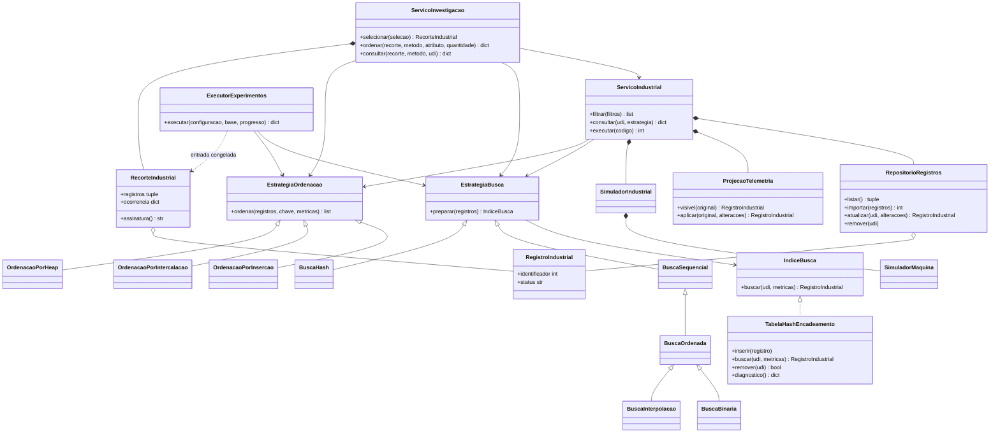

# IndustrialData — fundamentação e protocolo experimental

## Problema e perguntas

O problema consiste em consultar e manter registros de operação industrial com chaves únicas e medições numéricas. Um índice pode acelerar cada consulta e ainda aumentar o custo total em uma coleção pequena ou com poucos acessos. O projeto mede quando a preparação e as atualizações se pagam e examina como a ordenação prévia, a distribuição das chaves e a capacidade da tabela influenciam esse resultado.

| Pergunta | Hipótese |
| --- | --- |
| Qual ordenação é mais sensível ao arranjo inicial? | Insertion Sort melhora em ordem crescente e se aproxima do limite quadrático em ordem inversa. |
| A distribuição de UDIs afeta todas as consultas do mesmo modo? | A interpolação funciona bem em chaves equidistantes e degrada com concentração. A busca binária mantém a redução pela metade. |
| Aumentar a capacidade reduz as colisões? | A relação depende de como a capacidade interage com o resíduo das chaves na função hash. |
| Em que lote um índice compensa? | O ganho por consulta pode amortizar a preparação. A quantidade necessária depende do tamanho e da distribuição. |
| Como as mutações mudam a escolha? | Vetores ordenados deslocam elementos em atualizações estruturais e a tabela hash pode limitar esse trabalho a um balde. |

## Caracterização da AI4I

AI4I 2020 Predictive Maintenance Dataset, UCI Machine Learning Repository, 2020, DOI [10.24432/C5HS5C](https://doi.org/10.24432/C5HS5C), licença [CC BY 4.0](https://creativecommons.org/licenses/by/4.0/). São observações sintéticas usadas para representar características de processos industriais.

A inspeção de `data/ai4i2020.csv` encontrou **10.000 linhas de dados, 14 colunas, zero campos vazios, zero linhas duplicadas e zero UDIs duplicados**. Os UDIs vão de 1 a 10.000 e todos os valores de `Product ID` são distintos. A distribuição observada dos tipos é L 6.000, M 2.997 e H 1.003. O rótulo `Machine failure` vale 1 em 339 observações. Os indicadores TWF, HDF, PWF, OSF e RNF valem 1 em 46, 115, 95, 98 e 19 observações, respectivamente. Há nove linhas com rótulo de falha ativo e todos os indicadores específicos inativos, além de 18 no caso inverso. Cada campo foi preservado tal como fornecido.

| Cabeçalho original | Campo de trabalho | Mínimo | Mediana | Máximo |
| --- | --- | ---: | ---: | ---: |
| UDI | identificador | 1 | 5.000,5 | 10.000 |
| Product ID | produto | | | |
| Type | tipo | | | |
| Air temperature [K] | temperatura_ar | 295,3 | 300,1 | 304,5 |
| Process temperature [K] | temperatura_processo | 305,7 | 310,1 | 313,8 |
| Rotational speed [rpm] | rpm | 1.168 | 1.503 | 2.886 |
| Torque [Nm] | torque | 3,8 | 40,1 | 76,6 |
| Tool wear [min] | desgaste | 0 | 108 | 253 |
| Machine failure | falha | 0 | 0 | 1 |
| TWF, HDF, PWF, OSF, RNF | twf, hdf, pwf, osf, rnf | 0 | 0 | 1 |

A cópia converte medições para números tipados, traduz cabeçalhos e acrescenta fonte, equipamento, ciclo e alerta. As temperaturas permanecem em Kelvin. O atributo equipamento fica vazio e o ciclo é zero nas linhas AI4I. O status apresenta `Machine failure` como Falha. Os experimentos partem desse original, inclusive depois de edições no trabalho. O SHA-256 registrado antes e depois da implementação é `dc6630cd9b1f0f853922fad78a1b6436570d3f1ec863f1dd5c4340ac56bc8a8e`.

## Arquitetura e contratos

Flask compõe instâncias dos serviços e as injeta nas rotas. A mesma interface abstrata atende a todas as ordenações. Uma busca prepara um índice com a operação `buscar`, que devolve a entidade encontrada ou `None`. A troca de estratégia usa o mesmo contrato. Cada contagem recebe uma instância de `Metricas`; a passagem de tempo chama o método sem atualizar contadores.

A entidade exige UDI inteiro não negativo, medições finitas, códigos e indicadores válidos. Ela é imutável. O repositório substitui a entidade para atualizar atributos e mantém a unicidade por UDI. Seu snapshot é uma tupla de entidades imutáveis. Em uma alteração, o arquivo temporário é gravado no mesmo volume, sincronizado e renomeado atomicamente. A troca do snapshot e a invalidação dos índices seguem o sucesso da gravação.

O histórico de ciclos permanece arquivado. Ajustes cadastrados em **Registros** são versionados pela projeção local, inclusive remoções. Depois de uma mutação, a primeira consulta reconstrói a estrutura necessária com o snapshot atualizado. Consultas subsequentes podem reutilizá-la. Em JSON, UDIs acima de 2⁵³−1 são enviados como texto decimal para preservar sua precisão no navegador.

## Simulação por ciclos

Cada máquina tem parâmetros, estado, contador de ciclo e desgaste próprios. A semente composta usa a semente de configuração, o número da máquina e o ciclo. Os valores iniciais próximos a 1.500 rpm, 40 Nm e 310 K foram inspirados na distribuição AI4I. A referência de temperatura do ar é a temperatura simulada do processo menos 10 K.

| Modo | RPM configurada | Torque configurado | Temperatura configurada | Incremento de desgaste por ciclo |
| --- | --- | --- | --- | ---: |
| Normal | ×1 | ×1 | sem deslocamento | 2 min |
| Sobrecarga | ×1,10 | ×1,45 | +8 K | 3 min |
| Desgaste acelerado | ×1 | ×1 | sem deslocamento | 8 min |
| Personalizado | ×1 | ×1 | sem deslocamento | 1 min |

As flutuações gaussianas têm desvio 12 rpm, 0,6 Nm e 0,18 K. A rotação é arredondada para inteiro, o torque e a temperatura para duas casas. O desgaste usa o máximo entre o valor acumulado e o configurado antes de somar o incremento. Salvar um novo valor de desgaste ajusta o acumulador da máquina selecionada. Reiniciar restaura o desgaste configurado e deixa a máquina Parada, preservando a numeração de ciclos.

Alerta é emitido ao atingir 85% do limite de torque ou rotação, 80% do limite de desgaste ou a temperatura limite menos 4 K, desde que o ciclo não resulte em falha. Atingir qualquer limite produz Falha, interrompe o lote daquela máquina e impede novos ciclos até o rearme. Falha provocada gera um ciclo marcado e um evento. Os indicadores de falha da simulação descrevem as regras didáticas acima. Os indicadores do arquivo AI4I mantêm a definição da UCI. A tela de estatísticas usa todos os ciclos arquivados, inclusive os que ultrapassam o limite da visualização recente.

### Lotes progressivos

O estado operacional expressa Parada, Operando, Alerta ou Falha. A fase do lote registra Inativa, Em execução, Pausada, Concluída, Interrompida ou Falhou. A pausa mantém leituras e condição; retomar invalida pedidos emitidos antes da mudança. A conclusão e a interrupção estacionam a unidade. O histórico e o contador acumulado sobrevivem ao rearme.

A fase, a identificação do lote, a versão, o progresso, a semente e os limites usados ficam no snapshot CSV de simulação junto com eventos e medições. Um pedido progressivo aceita até um ciclo por máquina e verifica a versão sob o bloqueio transacional. Dois pedidos com a mesma versão produzem no máximo um ciclo naquela unidade. A semente e os limites são capturados no início. A ordem de persistência determina UDIs globais. A sequência física de cada unidade depende de sua configuração, semente e ciclo, inclusive após pausa ou troca de tela.

Uma tela operacional visível envia pedidos com espera de aproximadamente 650 ms após cada resposta enquanto houver máquinas ativas. O servidor gera ciclos sob demanda. Uma tela fechada ou em segundo plano deixa de solicitar novos passos. A animação consome a última leitura, e seu ritmo é independente da geração dos ciclos no Flask.

### Apresentação de sensores

As telas operacionais convertem Celsius por `°C = K − 273,15`. O CSV de ciclos continua usando Kelvin. A carga operacional é o maior percentual entre RPM sobre limite de RPM e torque sobre limite de torque. Temperatura e desgaste têm diagnóstico próprio. As estatísticas contam ciclos, alertas e falhas arquivados. O desgaste acumulado exibido nas estatísticas é a leitura do último ciclo e pode cair após um rearme.

O torno e a fresadora usam um período de animação de `clamp(0,4 s, 2,6 s − RPM/1200, 2,4 s)`. A prensa usa `1,28 × período + 0,24 s` para representar o curso vertical. Esses períodos são escolhas de apresentação. Sem uma leitura ativa, o mecanismo permanece imóvel. A pausa congela o quadro da animação. Parada e falha interrompem o movimento, e a preferência de movimento reduzido desativa a animação preservando textos, cores e indicadores.

## Investigação e gestão das evidências

Cada medição simulada arquivada como Alerta ou Falha forma uma ocorrência com identificador `OC-{máquina}-{ciclo}` e referência explícita ao UDI. Quando há um evento de diagnóstico no mesmo equipamento e ciclo, o relatório incorpora suas condições registradas. O recorte padrão considera até 25 ciclos até a detecção, com limites inclusivos ajustáveis. Também se pode investigar operação normal. O histórico original da máquina conserva a afiliação, o ciclo e a condição registrados.

A investigação consulta a projeção de trabalho. Correções aparecem identificadas na medição associada. Após uma remoção, o UDI histórico ainda aparece como referência da ocorrência; o registro deixa de ser apresentado e retornado pelas buscas na coleção de trabalho. Ciclo, equipamento e UDI da telemetria arquivada são preservados nas correções. Os gráficos operacionais usam até 300 leituras do recorte; as estatísticas e o CSV usam a seleção completa.

O índice de uma consulta operacional depende do conteúdo do recorte e de sua estratégia. Leituras repetidas podem reutilizá-lo. A comparação de estratégias mede o preparo individual e a consulta separadamente, com uma passagem de contagem de sondas. Uma operação de escrita sem alteração conserva o snapshot e os índices. Em escritas efetivas, a página Registros informa o tempo de persistência e sincronização e os índices globais descartados. O preparo posterior aparece na próxima consulta. A ordenação operacional mede o tempo sem instrumentação e calcula comparações, movimentações e posições auxiliares em passagem separada. As saídas são verificadas pelo oráculo nativo.

As demonstrações de inserção, correção e remoção da hash e do custo do sistema usam estruturas privadas sobre o recorte. Os registros derivados desses ensaios existem apenas durante a medição. A seleção contextual via URL conserva origem, equipamento, ocorrência, intervalo e filtros. A navegação permite retornar à mesma investigação. Benchmarks de contexto congelam a entrada e registram filtros, quantidade e SHA-256; resultados persistidos permanecem associados à entrada congelada.

## Ordenação

Pré-condições comuns. A coleção contém entidades válidas. A chave lexicográfica é `(medição, UDI)`, com UDI único. A saída contém os mesmos objetos em ordem crescente, e a entrada permanece inalterada.

| Estratégia | Melhor caso | Pior caso | Espaço do núcleo |
| --- | --- | --- | --- |
| Insertion Sort | Θ(n) | Θ(n²) | Θ(1) |
| Merge Sort | Θ(n log n) | Θ(n log n) | Θ(n) de buffer + O(log n) de pilha |
| Heap Sort | Ω(n); com chaves todas iguais, Θ(n) | Θ(n log n) | Θ(1) |
| Construção bottom-up, isolada | Θ(n) | Θ(n) | Θ(1) |

As três estratégias usam Θ(n) de armazenamento total na API por materializar chaves e devolver uma nova lista. A contagem de posições auxiliares soma as posições do vetor de pares e, no Merge, as do buffer. O pico em bytes inclui alocações internas e a lista de saída viva. Comparações são decisões entre chaves de registros. Movimentações são escritas de elementos no vetor de trabalho ou no buffer, com duas por troca, sem contar a decoração de entrada e a lista de saída.

**Inserção.** Antes de inserir o item na posição `i`, o prefixo `[0,i)` está ordenado e contém os primeiros `i` itens. O algoritmo desloca uma posição à direita cada chave estritamente maior e põe o item no espaço liberado. No fim do laço, o prefixo cresceu e continua ordenado. Na ordem inversa de chaves distintas são feitas `n(n−1)/2` comparações.

**Intercalação.** O caso base tem zero ou um item. Por indução, ambas as metades estão ordenadas quando a intercalação começa. Em cada iteração, o menor entre os dois primeiros itens restantes é o próximo da ordem global. Em caso de empate, a esquerda tem precedência. Assim o intervalo copiado de volta está ordenado e preserva todos os elementos.

Para n potência de dois, o código satisfaz `T(n) = 2T(n/2) + Θ(n)` e `T(1) = Θ(1)`. Após j expansões, `T(n) = 2^j T(n/2^j) + j Θ(n)`. Em `j = log₂ n`, as folhas somam Θ(n) e os níveis somam Θ(n log n). Arredondar as duas metades para n arbitrário preserva o limite.

**Heap.** Em um heap máximo, toda chave de pai é maior ou igual à dos filhos. Em indexação a partir de zero, os filhos são `2i+1` e `2i+2`. A construção percorre de trás para frente somente os nós internos, cujos filhos já são raízes de heaps. A descida iterativa troca com o maior filho até restaurar a propriedade. A quantidade de nós de altura h é limitada por `ceil(n/2^(h+1))`, e o custo total das descidas de construção é Θ(n), pelo somatório geométrico das alturas. Uma extração troca a raiz com o último elemento da região ativa, encolhe o heap e restaura sua propriedade. O sufixo crescente contém os maiores itens já extraídos e nunca volta à região ativa. As n−1 extrações custam O(n log n), com Θ(n log n) no pior caso. No experimento, o desempate por UDI torna distintas as chaves completas, inclusive quando a medição se repete.

| Etapa | Região ativa | Sufixo ordenado |
| --- | --- | --- |
| Entrada | 4, 1, 3, 2, 5 | vazio |
| Descida a partir de 1 | 4, 5, 3, 2, 1 | vazio |
| Descida a partir de 0, heap pronto | 5, 4, 3, 2, 1 | vazio |
| Extração de 5 e restauração | 4, 2, 3, 1 | 5 |
| Extração de 4 e restauração | 3, 2, 1 | 4, 5 |
| Próximas extrações | 1 | 2, 3, 4, 5 |

## Consultas, atualizações e corretude

Cada índice recebe chaves únicas. Nenhum teste compara posições produzidas por estruturas diferentes. Os oráculos e as verificações usam o registro completo, incluindo atributos mutados.

| Estratégia | Preparação acadêmica | Consulta | Espaço do índice | Alteração na carga em memória |
| --- | --- | --- | --- | --- |
| Sequencial | Θ(1) para consultar uma sequência existente; Θ(n) para copiar a coleção mutável da carga | Melhor Θ(1), pior Θ(n) | Θ(1) para consulta | Anexar O(1) amortizado; editar e remover por UDI O(n) |
| Binária | Θ(n log n) usando Merge Sort | Melhor Θ(1), pior Θ(log n) | Θ(n) | Localização O(log n); inserção e remoção O(n) por deslocamentos |
| Interpolação | Θ(n log n) usando Merge Sort | Melhor Θ(1), esperado O(log log n) sob distribuição regular uniforme, pior Θ(n) | Θ(n) | A mesma manutenção do vetor ordenado |
| Hash | Θ(m+n) sob dispersão uniforme e carga limitada, pior O(m+n²) | Melhor Θ(1), esperado Θ(1+α), pior Θ(n) | Θ(m+n) | Θ(1+α) esperada com capacidade fixa e chaves bem dispersas; pior Θ(n) |

Na sequencial, os primeiros itens examinados já foram descartados. A binária guarda qualquer resposta possível no intervalo fechado `[início,fim]` e descarta metade após comparar com o meio. A interpolação verifica os dois limites e usa `início + (alvo − menor) × (fim − início) // (maior − menor)` com aritmética inteira. Quando menor e maior são iguais, examina uma única posição. Cada sonda sem sucesso restringe o intervalo e preserva todas as possíveis respostas.

Na tabela de capacidade m, a função é `h(udi) = udi % m`. A chave está exclusivamente em seu balde. A inserção de chave nova em um balde já ocupado conta uma colisão. Atualização troca o registro correspondente e remoção elimina só a chave pedida. O diagnóstico informa colisões acumuladas, capacidade, ocupação, maior balde e média nos baldes ocupados. Sob dispersão uniforme, a expectativa de elementos por balde é α = n/m. Com agrupamento de resíduos, baldes podem crescer mesmo quando α é pequeno. Passos contabilizam posições ou chaves examinadas, incluindo a encontrada. As verificações de limites da interpolação são parte do tempo e ficam fora do contador de sondas.

Na aplicação CSV, reconstruir após invalidar custa a preparação da tabela acima. A persistência reescreve o snapshot e acrescenta custo de I/O proporcional à coleção armazenada. O laboratório mede o custo em memória de forma isolada. A criação das chaves compostas, os vetores internos e o vetor de saída entram na medição das ordenações. Cópias e fatiamentos de entradas feitos para gerar distribuições ou preparar lotes acontecem antes do relógio. O fatiamento para apresentar extremos ocorre depois de cronometrar a ordenação.

## Protocolo empírico

- **Ordenação.** Cada tamanho usa a mesma amostra para as estratégias. A configuração varia entre aleatória, crescente pela chave completa, inversa pela mesma chave e cinco valores da medição principal repetidos com desempate pelo UDI. `sorted` aparece como referência nativa em série própria e como oráculo fora das medições dos algoritmos manuais.
- **Busca.** O mesmo lote embaralhado de 1.000 consultas contém exatamente 500 presentes e 500 ausentes. UDIs regulares são pares consecutivos. No perfil concentrado, a metade inicial tem espaçamento fixo e a segunda metade cresce quadraticamente. Entre as ausências do perfil concentrado há ímpares e pares em lacunas ou no limite superior. A coleção de entrada é embaralhada antes da preparação.
- **Hash.** Para cada n, todos os testes usam o mesmo lote e a mesma base concentrada. As capacidades são `ceil(n/α_alvo)` para cargas 0,25, 0,50 e 0,75. Os resultados mostram a carga real, colisões e passos observados.
- **Sistema.** A carga estática repete o lote de consultas. A dinâmica intercala 100 mutações no perfil de referência, em rodízio de inserção, alteração de torque e remoção. Todas as estratégias executam o mesmo roteiro e seus retornos são comparados com um oráculo. O tempo total inclui a preparação, o percurso do roteiro, as consultas e a manutenção incremental. Os tempos atribuídos a consultas e mutações excluem a coordenação do laço, contabilizada no total.
- **Medição.** As entradas são geradas com semente 42 + tamanho, fora da seção de tempo. Uma passagem instrumentada valida a corretude e aquece cada configuração. Cinco passagens sem instrumentação medem o tempo com `time.perf_counter_ns()`. Outras cinco medem o pico de alocações Python com `tracemalloc`, com coleta de lixo antes de cada passagem. O pico inclui a estrutura exigida e os resultados produzidos na passagem. Preparação, consultas, total, pico e contagens têm mediana e IIQ (Q3 − Q1 pelo método inclusivo). As contagens determinísticas da passagem instrumentada acompanham cada repetição. CSV, gráficos e geração de entradas ficam fora das janelas cronometradas.
- **Compensação.** Para cada estratégia, `T_total(Q) = T_preparacao + Q × T_consulta`. A estimativa compara as medianas com a sequencial, dividindo a preparação adicional pela economia unitária positiva. A observação usa as medianas do total em prefixos de 1, 10, 50, 100, 250, 500, 1.000 e, quando maior, no lote configurado. O primeiro prefixo vencedor é reportado. Se nenhum prefixo vencer, registra-se a ausência de compensação até o maior tamanho testado. A grade fornece um limite observado, com resolução igual ao espaçamento entre prefixos.

O benchmark dinâmico mede também uma reconstrução isolada do índice após as mutações, fora do total da estratégia de manutenção incremental. A reconstrução usa os registros finais do mesmo roteiro. Os gráficos de custo total mantêm a comparação de preparo, consultas e atualizações ao longo do roteiro. O CSV da execução completa exporta a coluna de reconstrução para os cenários dinâmicos.

## Recomendação e limites de inferência

A recomendação técnica depende da carga. A busca sequencial evita preparação em consultas isoladas; a busca binária tem comportamento previsível em UDIs irregulares e permite manter uma estrutura ordenada. A tabela hash é candidata para consultas exatas e mutações frequentes, desde que a capacidade e a dispersão dos resíduos sejam avaliadas. A interpolação depende da regularidade dos dados. Para ordenação de coleções grandes e inicialmente desordenadas, Merge Sort e Heap Sort são alternativas com garantia de pior caso. O Insertion Sort tem aplicação em sequências pequenas ou quase ordenadas.

As diferenças numéricas variam com máquina, Python, ruído do sistema e delineamento. As chaves sintéticas e a função módulo fixam padrões de colisão específicos. O pico de `tracemalloc` cobre alocações Python rastreadas e a simulação descreve regras didáticas. A [interpretação da execução incluída](resultados/interpretacao.md) liga essas hipóteses às medições exportadas.

## Material reaproveitado e ferramentas de apoio

A fonte de dados é a AI4I, com atribuição e licença CC BY 4.0. Os arquivos Chart.js, Inter e IBM Plex Mono são distribuídos localmente com licenças em `static/vendor/`. A identidade visual segue as especificações fornecidas no enunciado. O conector apresentou links de origem do protótipo Figma Make, mas o ambiente não abriu os arquivos. As estratégias acadêmicas foram escritas para este projeto, com as implementações Markdown e Python inspecionáveis. Codex foi usado como ferramenta de apoio para implementação, testes, integração e redação. Pytest, Ruff e Playwright foram usados na validação local.

## Identificação dos integrantes e contribuições individuais

| Integrante | Matrícula USP | Contribuição individual |
| --- | --- | --- |
| Vinicius Lazzeri | 15979921 | Concepção, desenvolvimento e integração da aplicação IndustrialData, abrangendo a arquitetura do sistema, a implementação das funcionalidades e a integração entre simulação, gerenciamento de registros e análise de algoritmos. |
| Rafael Nascimento | 18616390 | Pesquisa técnica e apoio à fundamentação teórica do projeto, com foco nos algoritmos, nas estruturas de dados e nos conceitos utilizados na análise experimental. |
| Wendel Avila | 18616319 | Suporte técnico-acadêmico à elaboração do projeto, incluindo pesquisa complementar e apoio à organização dos requisitos e à contextualização metodológica do trabalho. |

